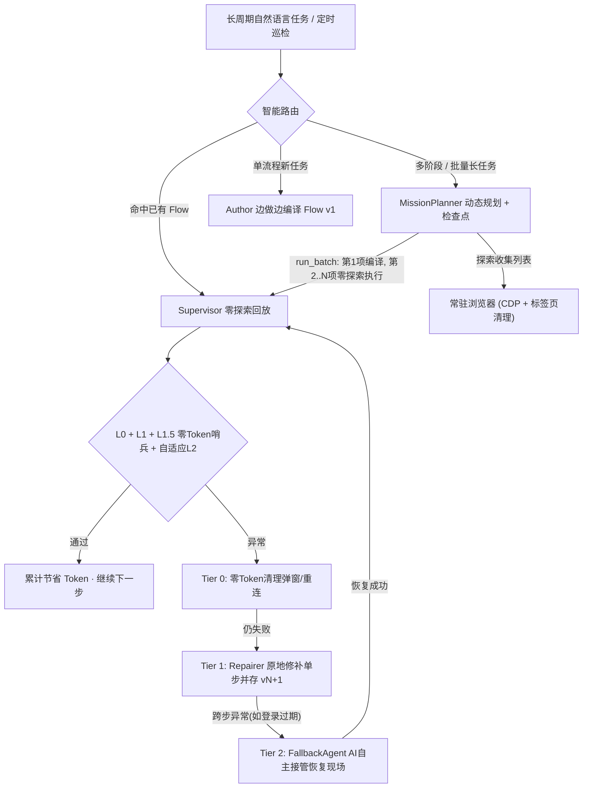

# cuaflow

**cuaflow** 是一个**面向长周期任务的自主电脑与浏览器操作智能体**，支持浏览器与 Windows 桌面操作。项目 fork 自 [microsoft/CUAWright](https://github.com/microsoft/CUAWright)（MIT）并全面重构。

### 核心设计理念
1. **AI 全流程自主规划执行长任务**：`MissionPlanner` 自动将复杂长任务（跨多阶段、多页翻页、数十上百条数据处理）拆解为动态执行计划（`explore` / `skill` / `batch` / `synthesize`），共享常驻浏览器登录态，持久化每一步与每一项检查点，支持**中断断点续跑（`resume`）**。
2. **录制脚本是为了省 Token**：
   - 跨任务直接复用已沉淀的参数化 `Flow` 脚本（**0 探索 Token**）；
   - **单次长任务内即时编译省 Token（`run_batch`）**：处理 N 条列表/分页任务时，AI 仅在第 1 条上操作并自动编译成参数化 `Flow`，第 2..N 条直接交给脚本高速执行；
   - 默认不重复回放刚录制完的任务（`verify_replay=False`），全链路统计真实 Token 消耗与脚本节省的 Token 数（`/api/stats`、`cuaflow stats`）。
3. **五层监督者 + 四级自愈保障脚本持续稳定不出错**：
   - **L0–L3 监督体系**（含 **L1.5 零 Token 浏览器运行时哨兵**：实时捕获主文档 HTTP 4xx/5xx、网络错误页、未捕获 JS 异常、登录失效重定向、弹窗遮挡、白屏与 DOM 卡死；平时 0 Token，仅在发现异常或定期抽检时**自适应唤醒 L2 视觉裁判**）。
   - **四级自愈恢复**：Tier 0 零 Token 浏览器自愈（清理弹窗/多余标签页/CDP 重连）→ Tier 1 `Repairer` 原地热修补单步代码并沉淀新版本 → Tier 2 `FallbackAgent` **AI 自主接管现场**（处理登录过期等跨步绕路后交回脚本继续执行）→ Tier 3 无人值守安全终止或人工工单。
4. **持续巡检与熔断保护（Schedules）**：支持将任意脚本或长任务设为定时持续监控任务，内置连续失败熔断器（Circuit Breaker），目标站点宕机时自动熔断防止空耗 Token。



## 安装（Windows 10/11 / Linux）

### 方式一：Windows 安装包直接安装（推荐，免装 Python / Node.js）

1. 前往 [GitHub Releases](https://github.com/yyy8080/cuaflow/releases) 下载 **`cuaflow-setup-0.1.0-win64.exe`**（或绿色免安装版 `cuaflow-portable-0.1.0-win64.zip`）。
2. 双击运行安装向导（无需管理员权限，自动创建桌面快捷方式并可选加入 `PATH` 与开机自启持续巡检）。
3. 双击桌面 **cuaflow** 图标，自动启动后台服务并打开 Web 控制台；进入 **「设置」** 页面直接粘贴模型 API Key 保存即可开箱使用（自动调用系统自带 Microsoft Edge / Chrome，无需额外下载浏览器内核；如需独立 Chromium 也可执行 `cuaflow install-browser`）。

### 方式二：本地一键打包生成安装包

```powershell
# Windows（生成 dist\cuaflow-setup-0.1.0-win64.exe 与便携版 .zip，需本机已装 Python 3.11+、Node.js 与 Inno Setup 6）
powershell -ExecutionPolicy Bypass -File .\packaging\build_windows.ps1
# 如需把独立 Chromium 一并打进全离线包，加 -BundleChromium 参数：
powershell -ExecutionPolicy Bypass -File .\packaging\build_windows.ps1 -BundleChromium
```

### 方式三：源码开发安装

```powershell
# Python 3.11+
git clone https://github.com/yyy8080/cuaflow; cd cuaflow
python -m venv .venv; .venv\Scripts\activate
pip install -e ".[win]"            # Linux 仅浏览器模式：pip install -e .
playwright install chromium        # Windows 下若已有 Edge/Chrome 可省略此步
cuaflow doctor                     # 检查环境
```

> Windows 桌面自动化需在**已登录的交互式桌面会话**中运行，详见 [docs/windows.md](docs/windows.md)。

## 配置模型（兼容 OpenAI Chat Completions 接口）

可在 Web 控制台 **「设置」** 页直接粘贴 API Key 保存，或通过命令行配置：

```powershell
cuaflow config model gpt-4.1 --base-url https://api.openai.com/v1 --api-key "sk-..."
# 或从环境变量读取（支持按角色独立配置 default | planner | author | supervisor | repairer | fallback | vision_judge | matcher）：
cuaflow config model qwen-vl-max --role vision_judge --base-url https://dashscope.aliyuncs.com/compatible-mode/v1 --api-key-env DASHSCOPE_API_KEY
cuaflow doctor --ping
```

## 使用

```powershell
# 1. 启动 Web 控制台 + 后台持续监控调度器
cuaflow serve                      # 打开终端输出的 http://127.0.0.1:8765/?token=...

# 2. 执行自然语言任务（自动路由：命中已有脚本 / 长任务自动规划 + 批量编译脚本 / 单流程录制）
cuaflow do "登录后台，遍历所有分页收集待审订单，逐条核验并汇总金额" --unattended
cuaflow do "导出本月销售报表" --mode auto

# 3. 长任务中断后从检查点无损续跑（已完成的阶段和批处理项不会重复执行）
cuaflow resume <task_id> --unattended

# 4. 查看沉淀脚本、Token 节省统计与持续监控计划
cuaflow stats
cuaflow flows ls
cuaflow run <flow_id> -p q=华东 --unattended
cuaflow schedules add "每5分钟订单巡检" --interval 300 --flow <flow_id>
cuaflow schedules ls
```

## 监督层级与自愈机制

| 层级 | 检查内容 | Token 消耗 |
|---|---|---|
| **L0** | 步骤异常、超时、Runner 子进程崩溃（崩溃自动从 `steps.jsonl` 检查点恢复） | **0** |
| **L1** | 步骤内 `expect.*` 确定性断言 | **0** |
| **L1.5（哨兵）** | 主文档 HTTP 4xx/5xx、网络错误页、未捕获 JS 异常、后台接口报错、意外跳转登录页、告警横幅、浏览器 `alert` 弹窗、白屏、DOM 无变化卡死、人机验证安全拦截 | **0** |
| **L2（视觉/语义）** | 默认 `on_change`（仅新步骤/修补步骤检查，通过后置零开销）；当 **L1.5 哨兵发现可疑信号**或达到定期抽检周期时**自适应唤醒** | 按需 1 次调用 |
| **L3（契约+终验）** | `output_schema` 输出字段非空契约校验（0 Token）+ 任务级最终核验 | 0 或 1 次调用 |

## 安全边界

- 服务默认只监听 `127.0.0.1`，所有 API 与 WebSocket 强制校验访问令牌。
- Shell 命令经过危险模式黑名单拦截。
- **人机验证安全红线**：遇到 CAPTCHA / Turnstile / 人机验证页面时，L1.5 哨兵被动识别后**立即停止自动操作**，绝不尝试绕过或破解，安全移交人工或终止报错。

## 开发与测试

```bash
pip install -e ".[test]" && playwright install chromium
pytest -q                                   # 含真实无头 Chromium 长任务批量编译、L1.5 哨兵、会话过期自主接管、断点续跑端到端测试
cd web && npm ci && npm run build && npx vitest run
```

REST/WebSocket 接口契约见 [docs/api.md](docs/api.md)。

## 许可

MIT。本项目基于 microsoft/CUAWright，详见 [LICENSE](LICENSE) 和 [NOTICE](NOTICE)。
