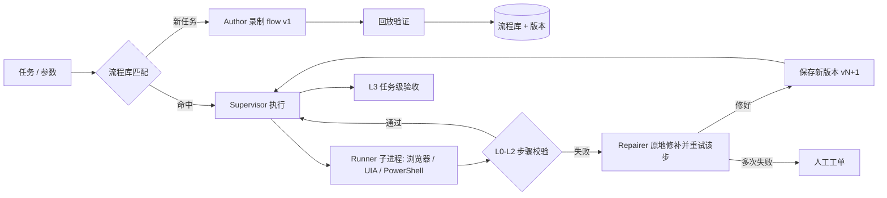

# cuaflow

**cuaflow** 是一个通用的电脑操作智能体，能操作浏览器和 Windows 桌面。它 fork 自 [microsoft/CUAWright](https://github.com/microsoft/CUAWright)（MIT），并做了较大改造。

- **一句话下达任务**：Author 智能体边操作边把过程**记录成分步骤的 Python 脚本（flow）**，存入流程库。
- **可重复执行**：相似任务会自动匹配已有 flow，换上新参数直接回放，不再调用大模型摸索。
- **监督者逐步检查**：执行时，Supervisor 在每一步结束后按 L0–L3 分层校验，判断这一步是否真的达到了预期。
- **自动修复**：某一步异常时，Repairer 在**同一个运行现场**（浏览器和窗口状态都保留）只重写这一步，重试通过后继续往下执行，修好的脚本另存为新版本，可以回滚。多次修不好就转人工处理。
- **Web 控制台**：可以下达任务、实时查看步骤执行情况、处理人工工单、查看版本 diff 和回滚。命令行作为辅助工具。



## 安装（Windows 10/11）

```powershell
# Python 3.11+
git clone https://github.com/yyy8080/cuaflow; cd cuaflow
python -m venv .venv; .venv\Scripts\activate
pip install -e ".[win]"
playwright install chromium        # 或使用系统 Edge：$env:CUAFLOW_BROWSER_CHANNEL="msedge"
cuaflow doctor                     # 检查环境
```

> 这个智能体需要在**已登录的交互式桌面会话**中运行（UIA 和截图依赖桌面会话），不能以服务方式运行在 Session 0。更多说明见 [docs/windows.md](docs/windows.md)。

## 配置模型（兼容 OpenAI Chat Completions 接口）

```powershell
$env:OPENAI_API_KEY="sk-..."
cuaflow config model gpt-4.1 --base-url https://api.openai.com/v1
# 可以为不同角色指定不同模型：author / supervisor / repairer / vision_judge / matcher
cuaflow config model qwen-vl-max --role vision_judge --base-url https://dashscope.aliyuncs.com/compatible-mode/v1 --api-key-env DASHSCOPE_API_KEY
# 模型不支持原生 tools 时：--tool-mode json
cuaflow doctor --ping
```

## 使用

```powershell
cuaflow serve                      # 打开 http://127.0.0.1:8765/?token=<终端里打印的 token>
cuaflow do "在记事本里写 hello 并保存到 C:\Temp\a.txt"     # 匹配已有 flow，或录制一个新的
cuaflow flows ls
cuaflow run <flow_id> -p text=hi -p path=C:\Temp\b.txt     # 在监督下执行（含自动修复）
cuaflow run <flow_id> --from-step save_as                   # 从指定步骤开始续跑
cuaflow flows rollback <flow_id> 1
cuaflow flows export <flow_id> my_flow.py
cuaflow run-file examples/notepad_flow.py -p text=hi -p path=C:\Temp\c.txt  # 不经监督者、不调用模型，直接回放
```

## Flow 脚本格式

```python
from cuaflow.flow import Ctx, Flow, expect

flow = Flow("导出报表", params={"q": {"type": "str", "description": "关键词"}},
            output={"result": "str"}, start_url="https://example.com/report")

@flow.step("打开报表页", expect="页面显示导出按钮")
def open_page(c: Ctx):
    page = c.browser.page()                       # Playwright 同步 API（Chromium/Edge，持久会话）
    page.goto(c.params.start_url)
    expect.visible(page.get_by_role("button", name="导出"))

@flow.step("保存到本地", expect="文件已生成", side_effect=True)
def save(c: Ctx):
    win = c.desktop.window(title_re=".*另存为.*")  # pywinauto UIA
    ...
    expect.file_exists(c.params.path)
```

每个步骤都是一个函数，带有自然语言的 `expect` 描述和确定性的 `expect.*` 断言。各步骤之间通过 `c.state` 传递数据（会写入检查点）。完整 API 见 [flow_api.md](src/cuaflow/agents/prompts/flow_api.md)，示例见 [examples/](examples/)。

## 监督层级

| 层级 | 检查内容 | 成本 |
|---|---|---|
| L0 | 步骤是否抛异常、是否超时、Runner 进程是否崩溃 | 无 |
| L1 | 步骤内的 `expect.*` 确定性断言 | 无 |
| L2 | 视觉模型对比步骤结束后的截图和 `expect` 描述。策略可选 `always` / `on_change`（默认，只检查新步骤和刚修改过的步骤）/ `sample` / `off` | 一次视觉调用 |
| L3 | 整个任务结束后，判断输出和最终画面是否满足任务意图 | 一次调用 |

某一步失败时的处理顺序：
1. 按 `retries` 重试。
2. Repairer 观察现场（截图、无障碍树、UIA 树、报错），重写这一步并在原地重试，最多 `max_repair_attempts` 次。
3. 仍然失败就生成人工工单，可选择 继续 / 提示后再修 / 跳过 / 中止。
4. 修复成功后，新版本自动入库。
5. 如果新版本连续失败，自动回滚到上一个版本。

## 安全

- 服务默认只监听 `127.0.0.1`，所有接口都需要 token。
- Shell 命令经过黑名单过滤（如 `format`、`rm -rf /`、`Remove-Item -Recurse C:\` 等），可在设置里调整。
- 标记了 `side_effect=True` 的步骤不会被盲目重试；有副作用的 flow 在录制完成后跳过回放验证。

## 开发

```bash
pip install -e ".[test]" && playwright install chromium
pytest -q                                   # Linux 下用 FakeDesktop 和无头 Chromium 运行，包括端到端自愈测试
pytest -m windows tests/platform            # 仅限 Windows：真实的记事本冒烟测试
cd web && npm ci && npm run build           # 控制台（React + Vite），构建产物输出到 src/cuaflow/server/static
```

REST/WebSocket 接口文档见 [docs/api.md](docs/api.md)。

## 许可

MIT。本项目基于 microsoft/CUAWright，详见 [LICENSE](LICENSE) 和 [NOTICE](NOTICE)。
